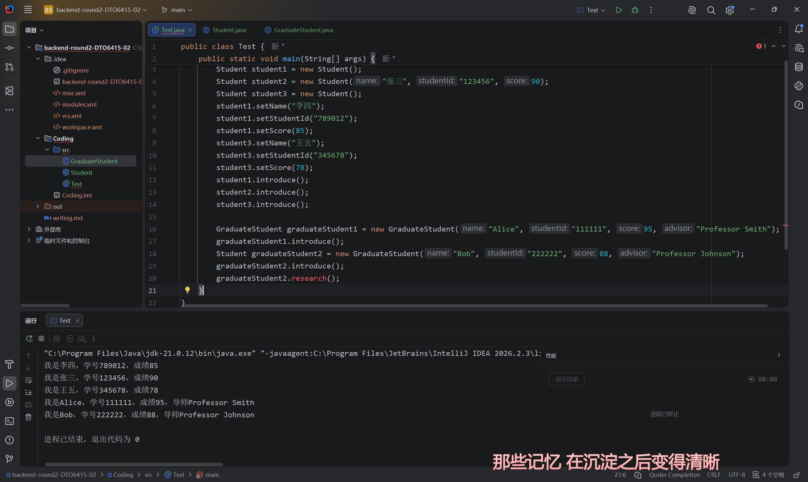

# T2

## 写代码之前

1. 关于面向对象和面向过程编程：
    在我看来，面向过程编程思维的核心关注点在于问题本身，这种思想将问题拆解成若干步骤，而不去重点关注问题中涉及的个体；因此，当遇到的问题较为简单、体量较小、重点在于需要解决问题的逻辑，面向过程编程是较为合适的，这也让我明白为什么T1中的业务，以及我学过的算法竞赛是使用面向过程编程思维实现的。

    而面向对象编程思维，更多的是先把问题放一边，观察整个发生问题的环境、与问题相关的个体，创建个体利用其交互来解决问题的思想。当需要实现的业务体量庞大、问题复杂时，面向对象编程思想可以通过系统化地管理个体、忽视问题细枝末节，直接使用打包好的逻辑语句来更高效的实现业务，解决问题。

2. 关于类和对象：
    其实我认为这两个名字很直观，类就是定义了某类个体的特征的一个规则，而对象就是符合这套规则、拥有这类特征的个体。举个例子，软件工程专业学生是一个类，这个类规定了其下的对象有招新网站id、有学号、会在招新网站上交题，我和其他招新小登都有这些特征，因此都属于这类中的对象。

3. 面向对象编程思想的三个要素
   1. 封装：
        封装意味着在面向对象编程中，某些操作或逻辑会以封装好的形式直接被调用。例如，要做一个图书馆借阅系统，coder可以直接把借阅这一行为封装为一个方法，其他coder进行开发时就无需关注这个行为实现的背后逻辑。
   2. 继承：
        顾名思义，在面向对象编程中，类之间可以进行继承：当几个类共用某些特征时，可以将其总结，创建一个共同的父类，编写时便无需重复书写这些代码。例如，安卓手机和苹果手机都是手机，可以创建一个“手机”父类，这样创建安卓和苹果两个类时无需再加上能打电话、看视频等这些公用的特征，建立继承关系即可。
   3. 多态：
        由于上述的继承这个要素，我们可以发现可以用一种父类的形式代指不同子类：例如，我们可以说一个person变量是student，也可以是teacher。实现多态的优点体现在，当我们写一个普遍性的方法时无需根据不同传入对象的类型分别写不同名称的方法，只需零传入对象的类型为父类即可。

## 代码

1. 我按要求设计了`Student`类，并且注意了`setScore`操作的条件，将分数控制在0~100范围内。

接着，我在main方法里分别用无参构造和有参构造新建了三个`Student`对象，并调用了其`introduce`方法。


思考题：

   1. `private`的作用，我认为首先是防止外部类随意操作对象中的数据，只能通过规定的方法读取和更改对象的某些特征。例如，倘若令`Student`的`score`特征公开，则外部想怎么动它就怎么动，让它是非法值也无所谓，用`private`修饰再写一个合法的`setScore`方法就能完全断绝这种可能性。
   2. 如果一个构造方法不写，JVM会自动给我加上一个无参构造；倘若我只写一个有参构造，JVM便不会自动加上这个无参构造，此时再用无参构造便会报错。

   2. 按照要求我又设计了`Student`类的子类`GraduateStudent`，继承了`Student`并增添了新特征，覆写了原方法`introduce`。接着，我用以下语句尝试令父类引用指向子类对象：

```Java
        Student graduateStudent2 = new GraduateStudent("Bob", "222222", 88, "Professor Johnson");
```

运行结果如下：


这意味着两个引用虽然类型不同，但执行的方法都是被覆写过的`introduce`方法。

不过当我试图调用这个`Student`类的对象的`research`方法时，虽然它的本质是`GraduateStudent`，但依然出现了报错：

(标红处便是出错的点)

思考题：

   1. 无参构造中这个`super()`哪怕不写，JVM也会自动加上，它到底是用来干嘛的？其实，当子类进行构造时，必须先进行父类特征的初始化，再进行子类特有特征的初始化；若父类没有无参构造，子类当然也不能进行无参构造，因为子类的无参构造必定调用`super()`，而这个方法是不存在的。
   2. 如果子类`GraduateStudent`不复写`introduce`方法，则调用时输出的结果会呈现为`Student`类的`introduce`方法的样式，没有“导师”一部分。
   `@Override`的作用：它有点像用`//`标注的注释，只不过这个`@`标注的语句叫做注解，不是给人看的 ~~(存疑)~~ ，而是给编译器看的：这个语句与注释一样对程序的运行无关紧要，但是对编译器来说就不一样了，编译器编译时不会检查注释，而会检查注解的下述语句是否真的是用于复写等的语句，这可以减小程序运行错误的概率。
   3. 其他实现多态的方法：在面向对象编程中，我们除了有父类与子类的继承关系，还有与其十分相似的“接口”，它与父类一样，都能打包某些实现类(类似于子类)的共有能力，不过本质区别在于父类与子类是真正意义上的类别关系，子类是父类的一种；而接口只是用于总结某些类的共有或相似能力。因此，一个子类只能有一个父类，却可以同时有若干接口。例如，可以创建一个接口，在其中定义一个`introduce`，当不同的子类作为它的实现类时，所执行的具体行为也是不同的，这也实现了多态。

## 理解与思考

1. 关于概念的理解：通过具体实践，我基本理解了面向对象编程思想，解答了我心中对编程思想的疑惑；`public`这个关键字虽然从学习之初就认识了，不过一直没有正确理解它，学习之后明白了它的意义。
2. 类与对象：在一开始我便解释过二者的关系，而我认为这二者可以类比为建筑图纸和实际盖出来的建筑：建筑图纸规定了这类建筑的结构、户型等，而同一张图纸也可以建造出不同设计与装修的建筑。
3. 面向对象到底解决了什么问题？我们为什么需要这种思想？我认为，面向对象思想赋予了我们从上帝视角看问题，将目光放到问题发生的环境、对象上，将问题简化，从而以普适性的方法解决较为复杂的问题。我们无需关心各个对象具体是怎么实现的，而是直接用对象已写好的块状的方法进行操作，这毫无疑问也有利于分工，更减轻了代码阅读量与代码重复度。